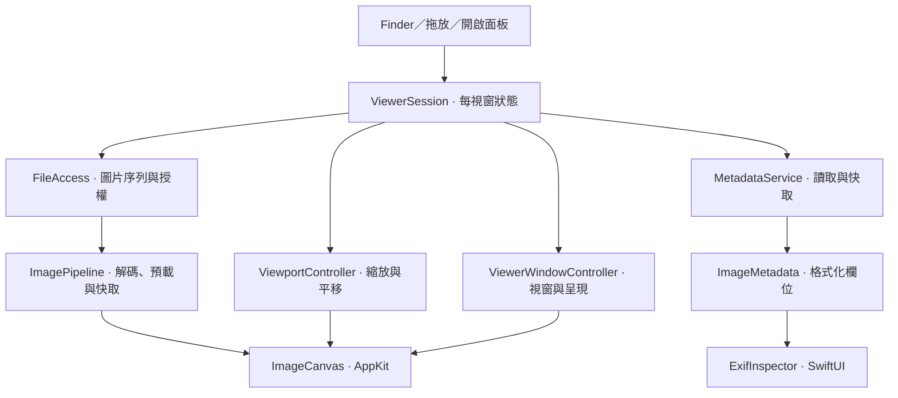

# Seeply

**Simply see.**

以看圖體驗為核心的 macOS 原生圖片瀏覽器。Swift 撰寫，AppKit 負責視窗與畫布，SwiftUI 負責介面。正式名稱為 **Seeply**，來自 Simply See 的變體。

**版本：0.1.7，專案與 App 正式更名為 Seeply。** 70 個跨平台核心測試通過，核心另通過 Swift 6 嚴格併發型別檢查。完整 macOS 建置與畫面顯示仍待 Mac 驗證。請見 [REVIEW.md](REVIEW.md) 與 [VALIDATION.md](VALIDATION.md)。

按 **⌘, → 檔案類型**，勾選要瀏覽的格式。預設全選，支援 JPG／JPEG、PNG、BMP、DNG 等 21 組格式選項，並提供「全選／全不選／常見圖片／只看 RAW」捷徑。未勾選的格式不會加入圖片、縮圖、EXIF、色票或預載的讀取請求。

Frameless 進入後先顯示控制列，滑鼠離開對應區域 **1.5 秒**後，上方工具列與下方縮圖／狀態列各自淡出。滑鼠移回視窗上方或下方區域時，只浮現對應控制列；停在該區域時保持顯示。照片中央的移動、點擊、縮放與鍵盤換圖不會喚醒已隱藏的控制列。隱藏過程不重新配置畫布，不改變照片倍率或平移位置。

一般視窗的控制列持續顯示。Lightbox／全螢幕保留原本滑鼠活動喚醒、閒置 2.6 秒後隱藏的方式；同時啟用 Frameless 時採 Frameless 的區域感應。縮圖總覽使用自己的操作介面，不疊加浮動控制列。

在「Seeply → 設定… → 一般 → 語系」選擇 **跟隨系統／繁體中文／English**。首次啟動預設跟隨系統：第一順位語言為繁體中文才使用繁中，其餘一律英文。手動選擇會保存，切換後直接更新介面、原生選單、EXIF 欄位與應用程式錯誤訊息，不需重啟或重新開圖。

0.1.3 將一般工具列由 54 pt 改為 40 pt，移除重複的標題區安全範圍留白，窄版工具列也會填滿視窗寬度。Window Fit 現在只改視窗尺寸、保留圖片倍率；超出螢幕時限制視窗大小，讓使用者以平移瀏覽圖片。完整看見圖片可另按 **0**。

「⋯」及「顯示」選單新增 **簡易 EXIF（E）**、**主色調色票（P）**，開關會保存。色票預設關閉；開啟後，在畫面下方顯示最多四個自動分析的代表色。滑鼠移上去可看 HEX 與約略佔比，點擊複製 HEX，右鍵可複製全部色碼或隱藏色票。這是全圖色票分析，縮放／平移不會改變取色範圍。

保留 0.1.2 的畫布裁切修正，避免放大影像越界覆蓋其他控制項。AppKit 的相關預設變更見 [Apple 的 macOS 14 release notes](https://developer.apple.com/documentation/macos-release-notes/appkit-release-notes-for-macos-14)。

## 開始使用

1. 在 **macOS 14 或以上**、已安裝 **Xcode 16 或以上**的 Mac 解壓縮。
2. 開啟 `Seeply.xcodeproj`，選擇 **Seeply → My Mac**。
3. 按 **⌘R** 編譯與執行。專案預設使用本機 ad-hoc 簽章，不需要第三方套件。
4. 選「檔案 → 開啟示範圖片」，或拖入自己的照片／資料夾。

若 Xcode 詢問簽章身分，可在 Signing & Capabilities 選擇 **Sign to Run Locally**。發佈用的 Developer ID、App Store 簽章與公證尚未設定。

## 更名與既有設定

專案資料夾、`Seeply.xcodeproj`、App Target／Scheme、`Seeply.app`、測試 Target 與 Swift 核心模組 `SeeplyCore` 均已更新；選單、視窗標題、介面與繁中翻譯使用 Seeply。

App 的 Bundle Identifier 刻意沿用 `local.luma.viewer`，測試 Bundle Identifier 沿用 `local.luma.viewer.tests`。既有偏好鍵保持相同，以保留語系、檔案類型及其他設定；程式顯示名稱與這些內部識別碼彼此獨立。示範圖的生成器來源與測試影像中的原始 EXIF 保留原值，因此相關資料仍可能出現舊暫名 Luma。

## 語系設定

按 **⌘,** 開啟設定。英文介面的路徑為 **Seeply → Settings… → General → Language**；語系選項始終保留「繁體中文」與「English」名稱，方便切換。

| 跟隨系統時的第一順位語言 | Seeply 預設語系 |
|---|---|
| 繁體中文：`zh-Hant`、`zh-Hant-TW`、`zh-Hant-HK` | 繁體中文 |
| 沒有明示字體的 `zh-TW`、`zh-HK`、`zh-MO` | 繁體中文 |
| 英文、日文、簡體中文、其他語言或無法辨識 | English |
| 日文第一、繁中第二 | English |

手動選擇優先於系統；選回「跟隨系統」即恢復上述規則。偵測發生在首次啟動及跟隨系統時，無須安裝程式。設定儲存在目前使用者的偏好設定；升級版本會保留。

切換語系會保留目前照片、縮放、平移、資訊面板與縮圖總覽的狀態。中繼資料快取保存語言無關的欄位，在顯示或複製時才翻譯；檔名、相機／鏡頭名稱與原始 EXIF 值保持原文。系統提供的標準對話框控制項、服務項目及系統錯誤細節仍由 macOS 決定語言。

## 檔案類型篩選

在 **Seeply → 設定… → 檔案類型**，或英文介面 **Seeply → Settings… → File Types** 設定：

| 分組 | 可選格式 |
|---|---|
| 常見圖片 | JPG／JPEG、PNG、BMP、TIFF／TIF、HEIC／HEIF、GIF、WebP、AVIF、JPEG 2000 |
| RAW | DNG、ARW、CR2、CR3、NEF、RAF、ORF、RW2、PEF、SRW、其他 RAW |
| 其他 | macOS ImageIO 支援、但不屬於以上選項的影像格式 |

- 初次使用預設全選。勾選會自動保存，並立即更新所有已開啟視窗。
- 依副檔名篩選，不分大小寫；例如 `.jpg`、`.jpeg`、`.JPG` 共用同一選項。這不會轉檔或更改原始影像。
- 「其他支援格式」不會繞過已取消的 JPG、DNG 等已知選項。「只看 RAW」選取列出的 RAW 組別；實際可解碼的機種與格式取決於 macOS ImageIO。
- 目前照片仍符合時保留已解碼影像與檢視狀態；若被排除，優先切到排序中下一張符合的照片，沒有下一張才退回上一張。
- 沒有符合圖片或全部取消時，顯示篩選提示，可直接進入檔案類型設定或恢復所有類型。全部取消會保存為空選取，不會在下次啟動偷偷改回全選。
- 重新勾選後，原先排除的圖片會回到瀏覽清單，不必重開資料夾。重新整理會重新掃描目錄；多選開啟則保留原始選取來源，不因篩選遺失檔案。
- 開啟圖片面板會停用未選取的格式，資料夾仍可進入。Finder 開檔、拖放與同資料夾展開也套用相同篩選。

目錄掃描仍會取得支援影像的檔名與基本檔案屬性，作為重新勾選時的來源清單；排除的影像不會進入後續解碼、縮圖、EXIF、色票或預載隊列。切換篩選會取消過期請求；已經開始執行的同步 ImageIO 工作可能繼續完成，但其結果不會回填到目前畫面。

## 目前包含

- Finder「打開檔案的應用程式」、拖放、多選圖片與開啟資料夾。
- 同資料夾自然排序、前後張、縮圖列及縮圖總覽；資料夾授權採唯讀。
- 游標位置縮放、觸控板捏合、兩指平移、滑鼠拖曳、滑鼠滾輪縮放。
- 雙擊在適合視窗／100% 之間切換；100% 以影像像素對應螢幕實體像素。
- **Lightbox**：暗底沉浸看圖，操作列閒置後隱藏。
- **Frameless**：真正無標題列的原生視窗；上下控制列各自於滑鼠離開後 1.5 秒隱藏，移回對應邊緣浮現；保留拖曳、縮放與鍵盤操作。
- **Window Fit**：依圖片當前顯示寬高調整視窗，逐軸限制於螢幕可用範圍，保留圖片倍率；與「圖片縮放至視窗」分開。
- 原生全螢幕、多視窗、顯示旋轉；每個視窗獨立保存目前檢視狀態。
- 浮動 EXIF 資訊面板、可選拍攝摘要、複製單一欄位／完整資訊。
- 可開關的四代表色色票，分析整張照片的預覽影像，支援複製 HEX。
- EXIF 方向修正，保留 ImageIO 解碼結果的色彩空間與 ICC 資訊。
- 背景解碼、解析度按需升級、相鄰預載、LRU 快取、過期請求隔離。
- 相同來源與解析度的並行請求共用解碼，取消一個等待者不影響其他等待者；最後一個等待者取消時才取消共用工作。
- 紙白／石墨灰／純黑畫布、循環換圖及保留縮放倍率設定。
- 繁體中文／英文即時切換、系統語言偵測與語系偏好保存。
- 可保存的檔案類型勾選、常見圖片／RAW 預設組合、所有視窗即時套用與空篩選提示。

EXIF 包含相機、鏡頭、光圈、快門、ISO、焦距、曝光補償、白平衡、測光、閃燈、拍攝時間與 GPS（來源有提供時）。檔案尺寸、格式與色彩描述檔歸於「影像與檔案」。缺少資料顯示「—」，不推測拍攝時區。

## 鍵盤與手勢

單鍵快捷鍵適用於照片檢視區；選單亦提供 Command 組合鍵。

| 操作 | 快捷鍵 |
|---|---|
| 開啟圖片／資料夾 | ⌘O／⇧⌘O |
| 新增視窗 | ⌘N |
| 上／下一張 | ←／→ |
| 第一／最後一張 | Home／End |
| 圖片縮放至視窗 | 0 或 ⌘0 |
| 原始像素 100% | 1 或 ⌘1 |
| 放大／縮小 | +／− 或 ⌘+／⌘− |
| 視窗配合圖片 | W 或 ⌘2 |
| Lightbox | L、空白鍵或 ⌘L |
| Frameless | B 或 ⌘B |
| 全螢幕 | F 或 ⌃⌘F |
| 照片資訊 | I 或 ⌘I |
| 簡易 EXIF | E 或 ⇧⌘I |
| 主色調色票 | P 或 ⇧⌘P |
| 縮圖列／縮圖總覽 | T／G，或 ⌘T／⌘G |
| 順時針顯示旋轉 | R 或 ⌥⌘R |
| 重新讀取 | ⌘R |
| 在 Finder 顯示 | ⇧⌘R |
| 複製目前顯示的圖片 | ⇧⌘C |
| 複製拍攝資訊 | ⌥⌘C |
| 關閉視窗 | ⌘W |
| 移動視窗 | 拖曳標頭；或 Option＋拖曳圖片 |

Frameless 且圖片適合視窗時，也能直接拖曳圖片移動視窗。放大後拖曳會平移照片。Esc 依序返回縮圖總覽、關閉資訊面板、退出 Lightbox、全螢幕與 Frameless。

## 架構



| 目錄 | 責任 |
|---|---|
| `Seeply/App` | AppKit 生命週期、選單、偏好設定 |
| `Seeply/Core` | 不依賴 UI 的縮放幾何、LRU、數值格式化與 EXIF 顯示模型 |
| `Seeply/Core/Localization.swift` | 語系偵測、繁中翻譯表、語言無關的文字與錯誤模型 |
| `Seeply/App/LocalizationUI.swift` | MainActor 上讀取目前語系，供原生介面與 SwiftUI 使用 |
| `Seeply/Core/ColorPalette.swift` | 透明度加權、Oklab 分群與代表色模型 |
| `Seeply/Core/ViewerLayoutMetrics.swift` | 工具列／縮圖列尺寸，供 SwiftUI 與視窗計算共用 |
| `Seeply/Core/ChromeAutoHide.swift` | 控制列顯示策略、各區域 hover 狀態與單調時間期限 |
| `Seeply/Core/ImageFileFilter.swift` | 副檔名分組、保存格式、篩選與選取位置決策 |
| `Seeply/UI/FileTypeSettingsView.swift` | 檔案類型設定與沒有符合圖片時的操作入口 |
| `Seeply/UI/ChromeHoverTracker.swift` | 不攔截點擊的 AppKit 邊緣滑鼠感應 |
| `Seeply/Models` | 圖片來源、授權生命週期與解碼結果 |
| `Seeply/Services` | 受限背景工作佇列、讀檔、ImageIO 與中繼資料 |
| `Seeply/Viewer` | 視窗、瀏覽狀態、互動與原生畫布 |
| `Seeply/UI` | 工具列、浮動資訊、縮圖、設定與空白畫面 |
| `SeeplyTests` | 82 個 XCTest：70 個跨平台核心測試、12 個 macOS 整合與繪圖測試 |
| `Package.swift` | 只供獨立建置與驗證核心；原生 App 仍由 Xcode 專案建置 |

UI 狀態由 MainActor 管理。影像與中繼資料快取由 actor 管理，阻塞的 ImageIO 工作送到限流的 OperationQueue。取消請求會立即釋放等待者；已在執行中的同步解碼可能繼續至完成，其結果不會覆蓋新圖片，讀取授權則保留至工作真正結束。

語系由 `Preferences` 統一管理。SwiftUI 監看偏好變更，AppKit 選單以穩定識別碼就地更新文字，保留動態 Window／Services 項目。翻譯使用英文字串作為來源與備援，繁中翻譯集中在 `StringCatalog`；`Info.plist` 的 `CFBundleLocalizations` 宣告 `en` 與 `zh-Hant`。不修改系統語言或 `AppleLanguages`，也不重建照片畫布。

控制列自動隱藏由可獨立測試的 `ChromeAutoHide` 決定，每個視窗使用自己的狀態與可取消計時工作。邊緣感應採 `NSTrackingArea`，感應 view 的 `hitTest` 回傳 `nil`，讓點擊、滾動及拖曳由真正的圖片或控制項接收。隱藏時保留感應區與控制列的 view 身分，只改變內容透明度、點擊及輔助使用可見性，避免淡出觸發 `onDisappear` 後又立即浮現，並保留縮圖捲動位置。相關 AppKit 行為見 [Using Tracking-Area Objects](https://developer.apple.com/library/archive/documentation/Cocoa/Conceptual/EventOverview/TrackingAreaObjects/TrackingAreaObjects.html) 與 [NSView.hitTest](https://developer.apple.com/documentation/appkit/nsview/hittest(_:))。

檔案類型偏好保存為 `enabledImageFileTypes`。`ViewerSession` 保存來源清單與授權生命週期，只將篩選結果提供給瀏覽、縮圖與各項背景服務；非同步開啟完成時採用最新設定。空清單不釋放仍需用於重新勾選的來源授權。原生開啟面板使用 [panel(_:shouldEnable:)](https://developer.apple.com/documentation/appkit/nsopensavepaneldelegate/panel(_:shouldenable:)) 與 [validateVisibleColumns()](https://developer.apple.com/documentation/appkit/nssavepanel/validatevisiblecolumns()) 更新格式可選狀態。

## 測試

在 Mac 執行：

```bash
./scripts/check.sh
```

亦可在 Xcode 按 **⌘U**。測試涵蓋游標錨定、Retina 比例、平移邊界、旋轉、負座標螢幕的 Window Fit、控制列自動隱藏、LRU、數值格式、檔案類型與即時篩選、語系偵測與翻譯、EXIF 方向、GPS、缺少 EXIF、壞圖及取消工作。

使用 Swift 6.0 以上編譯器，可在 macOS／Linux 獨立執行 70 個核心測試，無外部套件依賴：

```bash
swift test
```

核心的 Swift 6 嚴格併發型別檢查可另執行：

```bash
swiftc -swift-version 6 -strict-concurrency=complete -typecheck Seeply/Core/*.swift
```

`swift test` 使用 Package.swift 預設的 Swift 5 語言模式；這與上面的 Swift 6 型別檢查分開，並不表示整個 App 或 XCTest 自動產生的 runner 都已切換成 Swift 6。

`check.sh` 為方便建置測試，停用簽章；**沙盒的實際資料夾權限需另以 Xcode 正常簽章執行驗證**。

## 初版範圍與實作限制

- 這是原始碼專案，尚未產生已簽章的 `.app`／`.dmg`。
- 實際可開啟格式取決於系統 ImageIO。GIF、多頁 TIFF、HEIF 目前顯示主要靜態影像；未實作動畫播放、多頁導航或 RAW 顯影流程。
- 一般照片可按需解碼至原始解析度；極大型圖片會受單張像素預算限制。出現限制時狀態列會顯示提示。尚未實作分塊／金字塔渲染或 HDR／EDR 輸出。
- 影像 LRU 快取預算依記憶體大小為 128–512 MiB；目前視窗持有的圖片、執行中的解碼及縮圖另計。尚未進行實機記憶體與效能量測。
- 資料夾僅掃描當層；外部檔案變更用 ⌘R 重新讀取。授權只保留於當次工作階段。
- 畫面旋轉不修改檔案；複製圖片使用目前已解碼的版本，可能仍是預覽解析度。
- MakerNote 二進位資料不展開；原廠私有欄位不保證完整解析。
- 主色調色票從最長邊 192 像素的完整預覽取樣，轉成 sRGB，再以透明度加權、Oklab 感知色彩空間分群。HEX 是代表色近似值；單色或透明圖片可能少於四個色塊。分析在背景執行並快取，只有顯示色票時才啟動。

Oklab 轉換矩陣依 [Björn Ottosson 的公開公式](https://bottosson.github.io/posts/oklab/)（public domain）實作。

## 設計與資產

`Design/Legacy-Luma-UI-Concept.png` 是使用舊暫名 Luma 的歷史視覺草圖，**不是目前 Seeply 的原生執行截圖**，也尚未反映後續的緊湊工具列、主色調色票與設定頁更新；其中 EXIF 為展示排版的示範值。

三張內建示範圖是程式繪製的風景插畫，不是實拍照片，未偽造相機 EXIF。資產已包含在專案中，建置不需要 Python。若要重新產生：

```bash
# 僅重新產生開發資產時需要 Pillow 與 NumPy
python3 scripts/generate_assets.py
python3 scripts/generate_project.py
```

新增或刪除 Swift 檔案後，可執行 `generate_project.py` 更新專案。它只使用 Python 標準函式庫，不需 XcodeGen。
