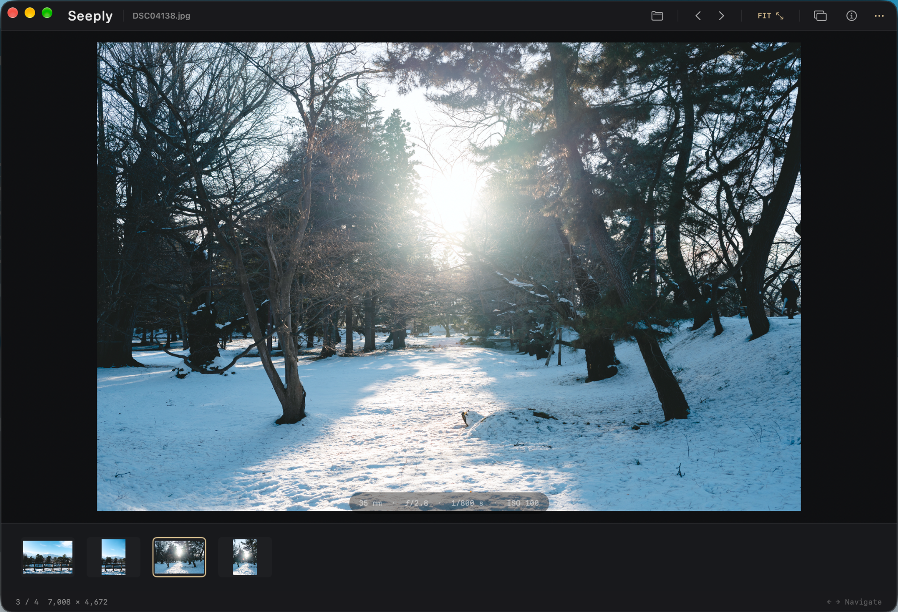
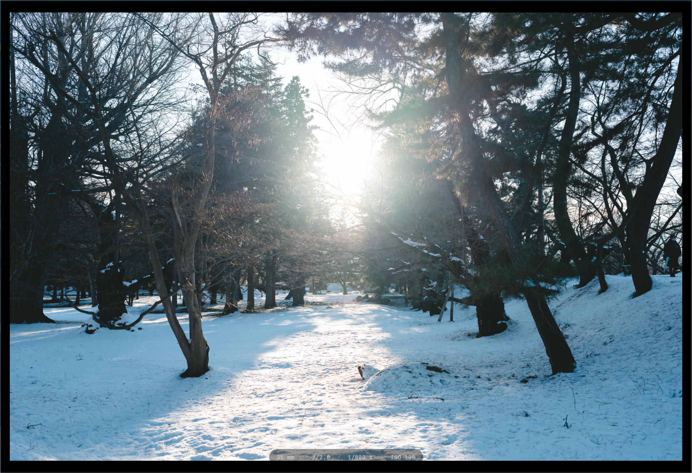
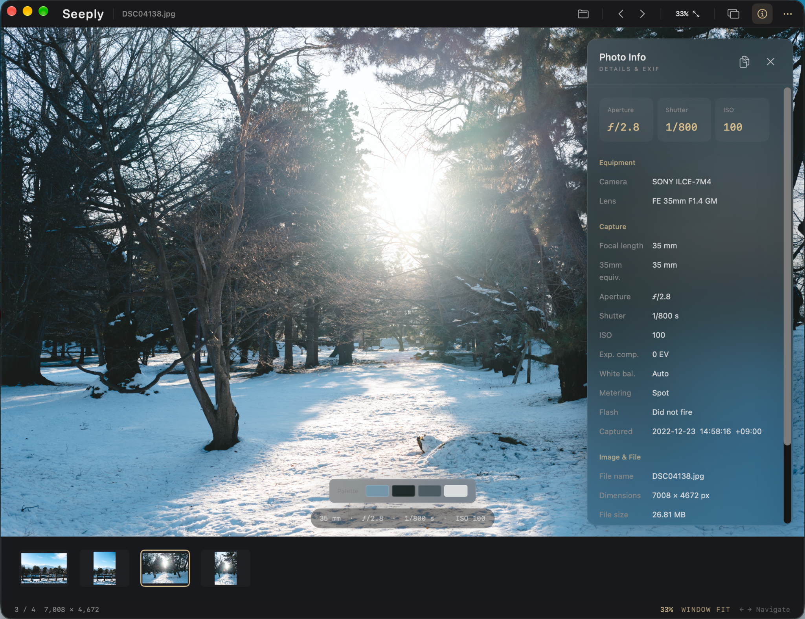
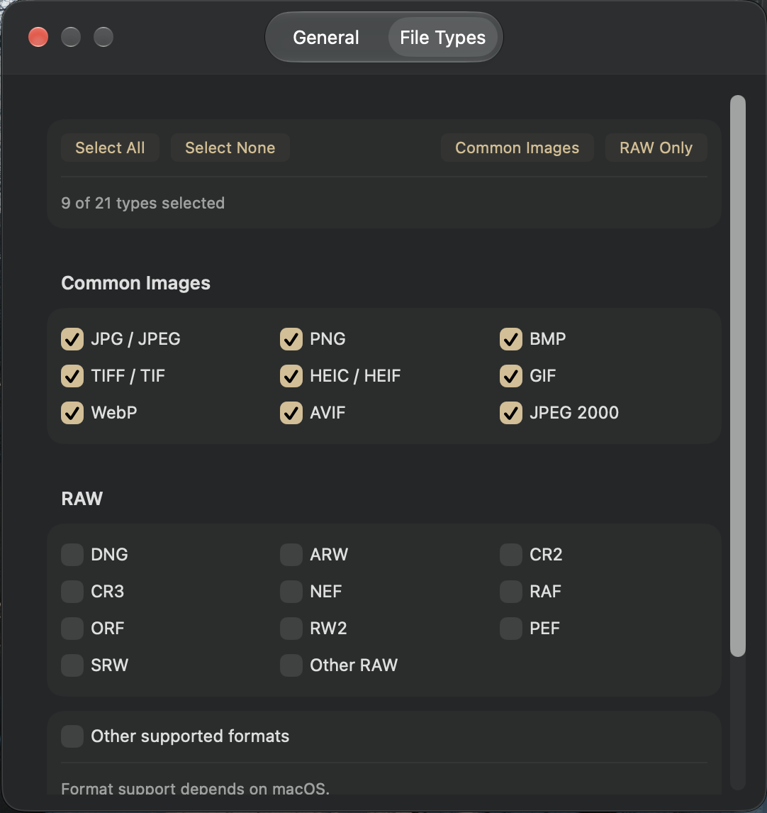

# Seeply

**Simply see.**

A minimal, native macOS image viewer focused on the viewing experience. Built with Swift, AppKit and SwiftUI.

English · [繁體中文](README.zh-TW.md)



## Features

- **Lightbox** — a dark, immersive canvas with controls that fade when idle.
- **Frameless** — a borderless window with independent top and bottom controls. Each bar fades out 1.5 seconds after the pointer leaves its region and returns when you hover that edge.
- **Window Fit** — resize the window to the displayed image while retaining its zoom level, within the screen's available bounds.
- **Precise viewing** — cursor-centered zoom, trackpad gestures, panning, rotation, Retina-aware actual pixels and fit-to-window.
- **Photo details** — EXIF inspector and an optional quick summary for camera, lens and exposure information when available.
- **Color palette** — up to four representative colors, with HEX codes and approximate proportions; click to copy.
- **File type filters** — choose JPG/JPEG, PNG, BMP, DNG and other image/RAW groups. Excluded types stay out of the browsing, thumbnail and preload queues.
- **Simple browsing** — Finder opening, drag and drop, natural ordering, filmstrip, contact sheet and multiple windows.
- **English and Traditional Chinese** — switch immediately in Settings. The primary system language selects Traditional Chinese only when it is Traditional Chinese; otherwise English is used.

## Screenshots

### Lightbox and Frameless

| Lightbox | Frameless |
| :---: | :---: |
|  |  |
| A dark canvas for immersive viewing. | A borderless window with controls that return when you hover an edge. |

### EXIF and color palette

View camera, lens and exposure details alongside up to four representative colors from the photograph.



### File type filters

Choose which formats enter the browsing queue. Here, common image types are enabled while RAW types are excluded.



## Build and run

Requirements: **macOS 14 or later**, **Xcode 16 or later**. No third-party Swift packages are required.

1. Clone or download this repository.
2. Open `Seeply.xcodeproj` in Xcode.
3. Select **Seeply → My Mac** and press **⌘R**.
4. Open your images, drop a folder into the window, or choose **File → Open Demo Images**.

The project uses local ad-hoc signing. If Xcode asks for a signing identity, select **Sign to Run Locally**. The bundled demo images are procedural landscape illustrations.

**v0.1.7 is a development source preview.** A signed and notarized `.app` or `.dmg` is not included.

## Shortcuts

Single-key shortcuts work in the image viewing area.

| Action | Shortcut |
|---|---|
| Open images / folder | ⌘O / ⇧⌘O |
| Previous / next image | ← / → |
| Fit image to window / actual pixels | 0 / 1 |
| Fit window to image | W |
| Lightbox / Frameless | L / B |
| Full screen | F |
| Photo info / quick EXIF | I / E |
| Color palette | P |
| Filmstrip / contact sheet | T / G |
| Rotate clockwise | R |
| Settings | ⌘, |

## Preferences

Use **Seeply → Settings… → File Types** to choose the formats to browse. All types are enabled initially. Selections are saved and apply to all open windows; uppercase extensions and common aliases are handled together.

The current photo keeps its decoded image and viewing state when it remains eligible. If it is excluded, Seeply selects the next eligible photo, or the previous one at the end. An empty result offers a shortcut back to file type settings or to restore all types.

Choose **Follow System**, **繁體中文** or **English** under **General → Language**. You can also configure the canvas background, quick EXIF, color palette, navigation looping and zoom retention.

## Development and validation

Run the native test suite on a Mac with Xcode:

```sh
./scripts/check.sh
```

Run the platform-independent core tests with Swift 6.0 or later:

```sh
swift test
```

The v0.1.7 source snapshot passed **70 core tests** and the core's Swift 6 strict concurrency type check. The **12 native macOS integration/drawing tests** and full native build still require Mac validation; this repository does not claim a completed native CI run.

See [validation details](VALIDATION.md), [development notes](DEVELOPMENT.md) and the [changelog](CHANGELOG.md).

## Current scope

- Formats and camera RAW compatibility depend on macOS ImageIO. Animated and multipage formats currently show their primary static image.
- Folder browsing scans one level; use **⌘R** to refresh external changes. This is a viewer, with deliberately limited file management.
- Very large images have a decoding budget. Tiled rendering and HDR/EDR output are not implemented.
- Display rotation does not modify the original file. The color palette samples a reduced preview of the entire image and is an approximation.

The palette's Oklab conversion follows [Björn Ottosson's published formulas](https://bottosson.github.io/posts/oklab/).
